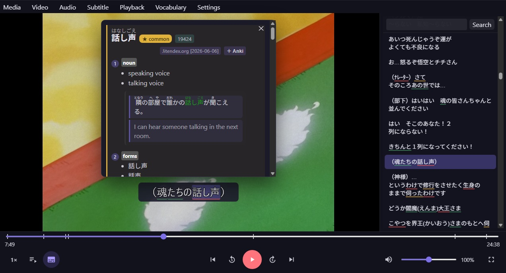
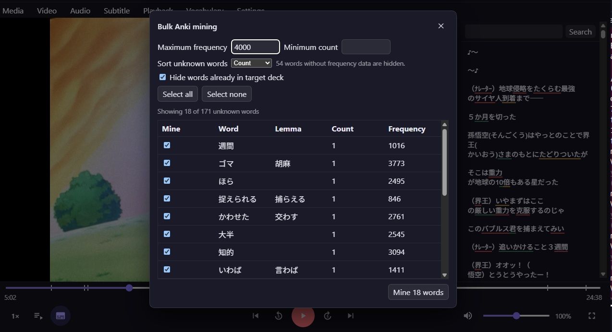

# Kizuna (絆)

Kizuna is a video player for Japanese learners with vocabulary knowledge
tracking, offline lookup, and individual or bulk Anki card mining.
Download builds from [Releases](../../releases).

## See Kizuna in action

### Watch and explore



### Prepare with bulk Anki mining



Turn unknown words in an episode into cards to review before watching.

## Features

- Play local video with embedded or external subtitles.
- Read selectable, tokenized Japanese subtitles over the video or in a sidebar.
- Track vocabulary knowledge and highlight words by knowledge level.
- Review vocabulary across an entire subtitle track and create Anki cards in
  bulk.
- Look up words with imported offline Yomitan dictionaries.
- Resume playback, restore subtitle and audio tracks, and navigate recent files.
- Use playlists, A–B looping, frame stepping, screenshots, mini-player mode, and
  configurable keyboard shortcuts.
- Optionally translate whole subtitle lines.

## Install a release

Kizuna publishes unsigned x64 builds for Windows 10 or newer and Ubuntu 24.04
(glibc 2.39). Download the package and `SHA256SUMS.txt` from the same entry on
the [Releases page](../../releases).

On Windows, run `kizuna-<version>-setup.exe` and follow the installer. The
installer is unsigned, so Windows may show an unknown-publisher or Microsoft
Defender SmartScreen warning.

On Ubuntu 24.04 x64, first verify the downloaded Linux package:

```bash
sha256sum --ignore-missing --check SHA256SUMS.txt
```

For desktop integration and automatic dependency installation, install the
deb package:

```bash
sudo apt install ./kizuna-<version>-linux-amd64.deb
# Later, to uninstall:
sudo apt remove kizuna
```

Alternatively, the AppImage runs without installation. Its bundled media tools
use the exact Ubuntu 24.04 mpv and FFmpeg libraries shown below:

```bash
sudo apt update
sudo apt install 'mpv=0.37.0-1ubuntu4' 'ffmpeg=7:6.1.1-3ubuntu5'
chmod +x kizuna-<version>-linux-x86_64.AppImage
./kizuna-<version>-linux-x86_64.AppImage
```

If FUSE mounting is unavailable, use the AppImage runtime's tested no-FUSE
path: `./kizuna-<version>-linux-x86_64.AppImage --appimage-extract-and-run`.
Kizuna requires X11 or XWayland for mpv embedding; native Wayland-only,
headless, container, and SSH-only sessions are unsupported. Run it as a normal
desktop user with Electron's sandbox available. Do not work around a sandbox
error with `--no-sandbox`; use the deb instead.

Both Linux packages are unsigned and may prompt a warning in software that
checks package signatures. Kizuna has an optional update check. When enabled in
Options > Setup & integrations, it checks GitHub once at startup; it never
downloads or installs an update without your confirmation. You can also check
manually from About > Updates. Disable the setting for a fully manual workflow.
When updating manually, download new versions from the Releases page and verify
their checksum before installing or replacing the AppImage.

## Optional services

- **AnkiConnect** enables individual and bulk card creation plus Anki knowledge
  sync. Its default endpoint is `http://127.0.0.1:8765`.
- **WaniKani** knowledge sync requires a personal access token, stored with
  Electron safe storage when available.

Neither service is required for video playback or local subtitle study.

## Optional dictionaries

Bundled IPADIC splits subtitles into words. Optional **MeCab UniDic** replaces
that tokenizer dictionary; **Yomitan-format dictionaries** provide offline
definitions, frequency ordering, and pitch metadata without replacing it.

### MeCab UniDic

Download a compiled, MeCab-compatible UniDic package from the [official UniDic
project and download page](https://clrd.ninjal.ac.jp/unidic/en/). Kizuna expects
the extracted dictionary folder to contain `char.bin`, `dicrc`, `matrix.bin`,
`sys.dic`, and `unk.dic` directly inside that folder. An arbitrary source
dictionary or a parent folder without these compiled files is not supported.

Install the folder in Kizuna's persistent user-data directory:

- Windows: `%APPDATA%\Kizuna\mecab\unidic`
- Linux: `~/.config/Kizuna/mecab/unidic`

Options > Parser & Dictionaries > Open UniDic folder creates and opens the
folder for you. After extracting the files, reopen Options or restart Kizuna,
then select UniDic under Options > Parser & Dictionaries. If the folder is
missing or has the wrong layout, Kizuna reports UniDic as **Missing** and keeps
bundled IPADIC available. Keep the dictionary in this persistent folder rather
than under the application installation/resources directory so application
updates cannot delete it. Unpackaged Linux development continues using the
system dictionary.

### Yomitan-format dictionaries

Find ZIPs on [Yomitan's maintained dictionary list](https://yomitan.wiki/dictionaries/),
including free Japanese options such as Jitendex and separate metadata dictionaries.
Do not extract them. Under Options > Parser & Dictionaries > Yomitan dictionaries,
choose **Import dictionaries…**, select a ZIP, and wait. Enable dictionaries and
use arrows to order them. Term dictionaries provide definitions; frequency and
pitch dictionaries add ordering and pitch metadata. Approximate JLPT levels are
community-sourced; the JLPT publishes no official vocabulary list.

The browser extension is unnecessary. Only supported Yomitan-format ZIPs import;
arbitrary ZIPs or unpacked folders do not. Datasets are not bundled: follow each
provider's licence and terms. Imported lookups work locally and offline.

## Privacy and network access

Playback, subtitle processing, dictionaries, settings, history, and vocabulary
data stay on the computer. Kizuna has no telemetry, analytics, account system,
or automatic crash upload. Imported dictionary lookup is local and does not
contact the dictionary source.

Network access is limited to enabled or manual update checks and explicit
translation, WaniKani sync, AnkiConnect, or [Jimaku](docs/jimaku.md) actions.
Translation sends only selected subtitle or OCR text to Azure; see
[translation setup](docs/game-ocr.md#translation-setup). A remote AnkiConnect
endpoint receives mined text and media; plain HTTP does not encrypt it.

Report security problems privately as described in
[SECURITY.md](SECURITY.md). Never post credentials or private data in an issue.

## Development

See [Contributing](CONTRIBUTING.md) for setup, checks, and packaging.
[Architecture](docs/architecture.md) and the [codebase map](docs/codebase-map.md)
cover implementation; [binaries](docs/binaries.md), [licensing](docs/licensing.md),
and [releasing](docs/releasing.md) cover distribution.

## Other documentation

- [Jimaku subtitles](docs/jimaku.md)
- [Game OCR (Windows, experimental)](docs/game-ocr.md)
- [Code of conduct](CODE_OF_CONDUCT.md)

## License

Copyright (C) 2026 Adam Kocsis.

Kizuna is free software licensed under
[GPL-3.0-or-later](LICENSE), without warranty. Bundled third-party components
remain under their own licenses; their notices and corresponding-source
information ship with the application and are documented in
[docs/licensing.md](docs/licensing.md).
